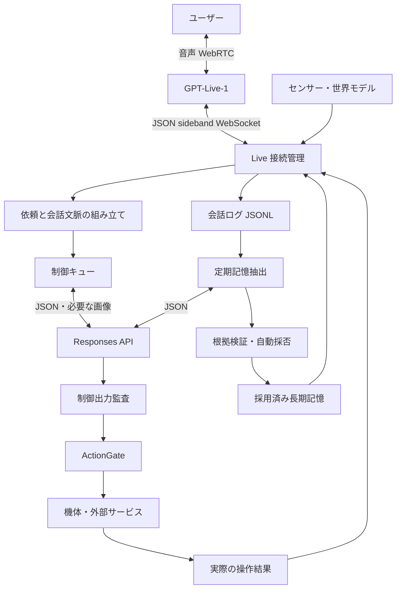

# Live 会話・カーネル分離仕様

現行構成: `codex/live-responses-kernel`。Puppeteer 版の復元元: `78127af`。

## 1. 目的と役割

PC のマイクとスピーカーを使い、ブラウザのボタンで音声会話を開始・終了する。
会話は `gpt-live-1` が担当し、視覚理解・機体制御・記憶処理にはカーネルが直接呼ぶ Responses API を使う。
身体状態、世界モデル、採用済み記憶、機体操作の監査・ActionGate・実行結果はカーネルが管理する。
音声の応答は Live が担当する。機体を操作する出力はカーネルで別途監査する。



## 2. 起動と設定

1. Node.js 22.6 以上と、このリポジトリの依存関係を用意する。
2. `.env.example` を参考に、サーバーの `.env` に `OPENAI_API_KEY` を設定する。
   Restricted キーでは Live と Responses の Write を有効にする。実セッションで
   `missing_scope` / `api.responses.write` が報告され、Responses Write がないと Live 内部の履歴圧縮が無効になることを確認した。
   Responses Write は機体制御・画像・記憶・検索の API 呼び出しにも必要。
3. `control_prompt.md` で能力と制約を確認する。人格設定ファイルは使用しない。
4. `npm ci` で依存関係をインストールする。
5. `npm start` または `node alice.js` を実行する。
6. `http://localhost:3000/` の「会話開始」を押し、マイク・音声再生を許可する。

キーはブラウザに返さない。API キーがない場合もカーネルと画面は起動できるが、Live 開始は 503 になる。
カーネル起動時に `control_prompt.md` を一度読み、Live と Responses が同じ内容を使う。
Live の各セッションの作成時に、全文を `session.instructions` として送る。会話中に同じ制御プロンプトを再送しない。
同じ文書内で役割を分け、Live には `Execution role: Live voice frontend`、Responses には `Execution role: Responses backend` を指定する。
Live は能力と制約を理解して自然な日本語で会話し、実処理が必要なら `<|SpawnThinking|>` で委譲する。
JSON 出力・`turn_id` の規則は Responses にだけ適用する。カメラ、LED、涙機構、公開投稿、人物登録、状態照会、記憶、検索の説明と制約は省略しない。
人格設定は開始時・会話中ともに読み込まず、送らない。旧 `live.personaPath`、`KOKOMI_PERSONA_PATH`、`behavior.persona` は使わず、制御入力に人格 ID や版を付けない。
ニュートラルな会話・相づち・割り込み・委譲の指示は、[公式の推奨テンプレート](https://developers.openai.com/api/docs/guides/live-prompting)を参考にして `control_prompt.md` に含める。
以前の `prompts/live-conversation.md` と `prompts/live-conversation.pre-neutral-2026-10-28.md` は比較用に残すが、実行時には読み込まない。
音声の選択と身体状態に応じた追加指示は引き続き使用する。過去の会話資料にある人格指示は採用しない。
制御プロンプトの編集を反映するにはカーネルを再起動し、新しい会話を開始する。
Responses の機体制御・画像解析にも全文を `instructions` として送る。記憶処理と検索には専用の指示を使う。

`KOKOMI_CONFIG_PATH` で別の設定ファイルを指定できる。隔離起動テストでは一時ファイルを使い、
実運用の観測・記憶ファイルを変更せず、センサー通信もローカルの偽デバイスへ向ける。

## 3. ライフサイクル

| 契機 | 動作 |
|---|---|
| カーネル起動 | 観測・記憶・会話ログ・抽出チェックポイントを復元。Live 接続は作らない。残った会話の抽出は再開できる。 |
| 会話開始 | ブラウザがマイク取得、SDP offer を作成。サーバーが Live セッションを作り、同じセッションの sideband に接続して SDP answer を返す。 |
| 音声開始待ち | sideband の接続成功だけでは会話中にしない。`session.started` を受け取るまで身体状態・話し方の append を送らない。ブラウザ側の開始通知も所有トークン付き heartbeat でカーネルに伝える。 |
| 会話中 | WebRTC で聞く・話す。サーバーは文字起こしを保存。音声会話は Responses の完了を待たない。 |
| 機体・視覚の依頼 | 委譲通知と、その時点の文字起こしを結びつけてバックエンドへ送る。 |
| 定期記憶処理 | 約 60 秒ごとに未処理範囲を選び、低優先度の抽出処理を予約。会話は続く。 |
| 会話終了 | マイクと再生を直ちに停止。サーバーへ `session.close` を送り、終了・使用量の確認を待つ。残りの記憶抽出を予約。 |
| タブを閉じる | `sendBeacon` による終了を試みる。届かない場合は heartbeat の期限切れでサーバーが終了を試みる。 |
| 接続エラー | 自動で新しい有料セッションを作らない。画面のボタンで再接続する。 |
| イベント拒否 | `error` 単体では音声やマイクを停止しない。コード・メッセージ・対象パラメータ・クライアントイベント ID を警告表示し、会話ログの kernel レコードと状態 API の `lastEventError` に保存する。実際の切断や `session.closed` は別に処理する。 |
| 終了未確認 | エラーを表示。所有トークンを保持し、「会話終了」で sideband 再接続と終了を再試行。終了確認まで新規セッションを作らない。 |
| カーネルの通常終了 | SIGINT/SIGTERM では Live の終了確認と会話ログの書き込みを待つ。強制終了では未処理ログを次回起動で回収。 |

「会話終了」は機体の緊急停止ではない。視覚処理・記憶抽出は継続して結果を保存できる。
そのセッションの未実行の機体操作は終了後に実行しない。すでに実行した操作は巻き戻さない。
終了後に届いた結果を新しい会話へ勝手に発話しない。

## 4. 通信

### 音声とイベント

- 音声: ブラウザと OpenAI の WebRTC メディアトラック。
- イベント: カーネルと OpenAI の sideband WebSocket。
- 作成: `POST https://api.openai.com/v1/live/sessions`。
- sideband: `wss://api.openai.com/v1/live/sessions/{session_id}/attach`。
- 委譲方式: `client`。バックエンドを OpenAI の別モデルへ自動変更しない。
- ブラウザ data channel は文字起こし・開始/終了・エラーの受信に限定し、送信可能イベントを空にする。
- sideband に反射される音声は保存・再生しない。音声の二重再生を防ぐ。

### Live から受け取るもの

`session.input_transcript.delta` と `session.output_transcript.delta` の `delta` を、
話者、`start_ms`、`end_ms`、セッション ID と一緒に保存する。空白・繰り返しを保持する。
断片は発話確定ではなく、出力側の文字起こしはユーザーが再生を最後まで聞いた証拠でもない。

`session.delegation.created` は委譲 ID と時刻などのメタデータのみで、依頼本文は含まない。
ダッシュボードでは委譲の受信を `Live delegation requested`、委譲中の処理失敗を `Live delegation failed` として表示する。
「これ見える？」「これ何かわかる？」などのカメラ質問は、Live の委譲が来ない場合もカーネルが安定した文字起こしから拾う。
`Camera request accepted` から撮影と読み取り専用の画像解析へ進み、同じ発話に対する後続の委譲では再撮影しない。
この経路は画像の説明だけを返す。機体を動かす依頼は通常の委譲・監査・ActionGate を通る。
カーネルは `offset_ms` に対応するユーザー発言を選び、その発言が落ち着くまで待つ。
その後の別の雑談を、元の依頼の本文に取り違えない。
期限内に依頼を確定できなければ、実行せず Live に聞き直しを求める。

### Live に送るもの

```json
{
  "type": "session.thinking.append",
  "event_id": "append_unique_id",
  "delegation_id": null,
  "content": "現在の身体観測: 温熱状態は快適。カメラ確認は進行中で、結果は未取得。"
}
```

| 種類 | 用途 |
|---|---|
| `session.thinking.append` | 身体の事実、関連する採用済み記憶、静かな進捗。 |
| `session.commentary.append` | ユーザーに伝える視覚結果や確認済みの操作結果。 |
| `session.instructions.append` | 話し方など、カーネルが定める指示。 |

本文は文字列。内部では JSON で管理し、接続アダプタで短い説明に変換する。
一般的な文脈共有は `delegation_id: null`、依頼への返答は受け取った委譲 ID を使う。
送信成功・受領通知は、内容を使った応答や実際の再生完了を保証しない。
受領待ちが増えた場合は新しい文脈の送信を保留し、会話自体は止めない。

## 5. 文脈と長期記憶の読み出し

長期記憶を全件 Live に転送しない。

- 開始時: 前回の要約、現在の身体状態、関連する採用済み記憶、直近の会話を予算内で渡す。過去の会話は記録時刻と話者を付けた参考資料としてまとめる。
- 新しい会話の開始時刻と、短い挨拶後に新しい発話を待つ指示を `developer` メッセージで渡す。過去の依頼や検索を実行中として再開しない。
- 検索の手掛かりがない開始時は、最近の採用済み長期記憶を設定件数まで選ぶ。
- 会話中: 最近のユーザー発言で既存 `MemoryStore.retrieve()` を検索し、未送信の記憶を追加。
- 既に開始時/会話中に共有した記憶 ID は、そのセッションで再送しない。
- 新しく採用された訂正版は別 ID なので追加できる。
- 500 トークン相当を超える追加情報は小分けにするが、保存済み記憶全体の転送には使わない。

公式 API の開始時 `input` と会話中 append は別の上限を持つ。
本実装は tokenizer 依存を増やさず、UTF-8 のバイト数をトークン数の保守的な上界として予算を検査する。
既定は開始時 6,000、追加１回 450。日本語では実際のトークン上限よりかなり短くなる。
コードポイント単位で分割し、サロゲートや UTF-8 文字を壊さない。
制御プロンプト全文・役割指定・身体状態による初期指示の合計にも 16,384 バイトの保守的上限を設ける。
超過時は省略せず、有料セッションを作る前に失敗させる。API 自体の instructions 上限 16,384 トークンとは単位が異なる。

## 6. 制御用 LLM

`task: "live_control"` の応答は次の形式。

```json
{
  "turn_id": "受け取ったターンID",
  "result": "机の上には赤いマグカップがあります。",
  "actions": [],
  "requests": []
}
```

- `result` は日本語の確認結果。`speech`・`emotion`・`intensity` はこの経路では拒否。
- 操作・情報照会の形式と値域は既存監査を使う。
- 生の LLM 出力から操作しない。リクエストと一致する `turn_id` と監査を通す。
- 画像照会ではカメラのスナップショットを Base64 の `input_image` として Responses に渡す。
- センサーの照会では stale / unknown を数値の現在値に置き換えない。
- 情報照会の後続ターンにも元のユーザー依頼を保持する。１依頼１操作の上限は後続ターンを通じて共有する。
- 操作がある場合、Live へ伝える完了情報は LLM の楽観的な `result` より実際の ActionGate/アダプタ結果を優先する。
- 訂正・取り消しの語を検出したら依頼の世代を更新し、古い応答から機体操作や発話を行わない。
- 依頼の有効期限を過ぎた結果も実行しない。視覚依頼と無関係な通常の雑談だけでは取り消さない。

制御キューでは複数の情報照会を含む依頼を順番に処理する。記憶抽出と根拠検証は別のキューを使う。
HTTP リクエストの期限は `responses.timeoutMs`。Live の依頼が失効した場合は進行中のリクエストも中断する。
HTTP 応答ごとに、完了状態・JSON・リクエストの `turn_id` を確認する。API の Structured Outputs で形を指定し、
カーネルが値域・操作権限を検証する。API には `store: false` を指定し、必要な会話履歴はカーネルから渡す。

公開情報の照会では `web_search` を単独の要求として返す。カーネルはユーザー依頼の場合にのみ、
公開クエリを専用の Responses リクエストに送る。Live には出典付きの回答内容を渡し、
ダッシュボードのアクティビティには出典リンクを表示する。

## 7. 記憶の抽出・採用

### 保存先と周期

- `live.conversationPath`: 会話断片とバックエンド結果の JSONL。初回は音声ファイルを録音しない。
- `live.checkpointPath`: 抽出済み位置、会話要約、適用途中の抽出結果。
- `memory.storagePath`: 既存の記憶候補・採用済み記憶ストア。

`memory.extraction.intervalSeconds` は秒単位。既定 **60 秒**。
メンテナンス周期で予約するため、厳密な実行時刻や60秒以内の完了は保証しない。
会話開始から数え、未処理範囲がなければ LLM を呼ばない。
実行中に終了要求などが重なっても並列抽出を作らない。終了時は残りを順に処理する。
「覚えて」と明示された場合は、依頼の文脈が落ち着いてから抽出を早める。

### 応答形式

以下はカーネルが保存用に復元した形式。API の抽出応答では候補に `evidence_refs`（例 `['u1','u3']`）を付け、引用文や断片IDの配列は出力しない。

```json
{
  "turn_id": "memory_job_unique_id",
  "memory_extraction": {
    "summary": "会話を再開するための短い事実ベースの要約",
    "candidates": [{
      "proposal": {
        "kind": "preference",
        "subject": "user",
        "content": "ユーザーは紅茶を好むと話した。",
        "confidence": 0.9,
        "evidence_event_ids": ["対応するユーザー発言のID"],
        "retention": "long"
      },
      "evidence": [{"quote": "紅茶が好きです。", "evidence_event_ids": ["対応するユーザー発言のID"]}],
      "explicit": true,
      "conflict": false
    }]
  }
}
```

候補がなくても `candidates: []` で成功を表現できる。
このタスクでは発話、機体操作、情報照会、社会的な操作権限の変更を受け付けない。
本文は一つの事実・出来事として自立する文章にする。同じ出来事についての短い回答は、
助手の質問をまたいでもまとめる。言い淀みを本文から取り除き、主語・対象を補うが、否定・留保・時期は変えない。
元の発言は `evidence` に複数の引用として別保存する。旧チェックポイントの `quote` 形式は読み取り互換を残す。

抽出後、同じ既存LLMへ別タスク `live_memory_review` を送り、会話全体と候補・既存記憶を再確認する。
返却形式は `{turn_id,memory_verification:{supported_indices:[0,...]}}`。
整理した本文の全内容がユーザー発言から裏付けられる候補だけを承認する。通常は抽出と照合の2往復になる。
この照合も記憶キューを使い、Liveの会話は継続する。機体操作やWeb検索を実行する経路ではない。

### 自動採用

既存の `pending → accepted / rejected` を維持し、次の条件を満たす通常記憶を自動採用する。

- 根拠が抽出対象範囲内のユーザー発言に存在する。
- 完全な文としての引用が一致し、否定や条件節を切り落としていない。
- 整理した本文は独立した照合で支持されている。確信度だけで意味の一致を確定しない。
- 本文に対応する全根拠IDが引用に含まれ、各引用が対象会話のユーザー発言と一致する。
- `explicit: true`、`conflict: false`。対象は `user`、保存期間は `long`。
- 種類は preference / episodic / semantic。関係の解釈は自動採用対象外。
- 秘密・資格情報・恒久的な権限変更や、仮定・不確実・訂正を含む発言は自動採用しない。
- 同じ対象・話題の好みが既存の採用済み内容と異なる場合は保留する。

確信度の高さだけでは採用しない。助手やカーネルの発言をユーザーの事実として自動採用しない。
条件を満たさない正常な候補は pending に残す。意味的な矛盾判断はモデル支援と保守的な規則であり、
一般的な真偽証明ではない。保留候補は既存の一覧・採否 API で判断する。

### 再試行とクラッシュ復旧

1. 抽出対象の終端を固定する。その後に届いた発言は次回へ回す。
2. 抽出結果と独立照合の承認一覧をチェックポイントに準備済みとして保存する。
3. 候補を保存し、条件を満たす候補を採用する。
4. すべて成功してから処理済み位置を進める。

保存途中で失敗した場合は、同じ準備済み結果と source key を再利用する。
モデルに違う候補を生成し直して二重適用しない。失敗時はカーソルを進めず、既定では30秒、60秒後に再試行する。3回連続で失敗すると再起動まで自動処理を保留する。
抽出・検証の入力は同一セッション内の最大16発話グループ。モデルには文字起こし断片のIDを送らず、ユーザー発話ごとの短い参照を渡す。カーネルが参照から保存用の原文引用と代表の断片IDを復元し、既存の根拠検証を適用する。
同一候補の再適用、近似重複の整理、採否履歴は既存ストアと整合させる。
ログ末尾だけの書きかけは復旧し、中間の破損は明示的なエラーにする。

### 既存の断片記憶の整理

ローカルの `data/runtime/memory-normalization-v2.json` に、元会話と照合した修復を予約した。
カーネルの起動時、通常の記憶処理が始まる前に適用する。元のファイルを
`memory.json.before-normalization-v2.json` に退避し、元レコードを消さず `superseded` として新しい記憶に関連付ける。
同じ修復は二重適用しない。ターミナルの一覧コマンド自体は修復を適用せず、読み取り専用のまま。
今回の服3件は1件へ、歌詞の1件は対象を補った文章へ整理する。個人の会話内容を含む修復データは
既存のランタイムデータと同様にGit対象外。引用が会話に見つからない修復は適用しない。

## 8. 身体状態と話し方

身体状態は既定２秒ごとに確認し、説明内容が変わった場合だけ送る。
モデルには温熱・明暗の分類と、在室、接触、見えている人物を共有する。数値のセンサー値はカーネル内部とダッシュボードに置く。
Responses の制御コンテキストとセンサー照会も定性的な値を返す。過去のログや記憶に残る数値の環境描写は、新しい会話の文脈から除外する。

`internal.homeostasis_sample` の `intoxication` を、既定0.2/0.6の境界で話し方の指示へ変換する。
信号名・境界は設定可能。信号が不明/古い場合は素面と断定せず、普段の話し方を使う。
これは Live への演技指示であり、音響パラメータの決定的制御ではない。
初期の話し方はセッション作成時の instructions に含め、開始直後に同じ指示を追加送信しない。
会話中の指示追加が発話を中断する場合があるため、開始直後の不要な割り込みを減らす。
アルコール測定からこの信号を算出する校正や、飲酒関連 P0 全体の実装は本変更に含めない。

## 9. 主要設定

| キー | 既定値 | 用途 |
|---|---:|---|
| `live.enabled` | true | false で Live 音声を停止。文字入力と推論は使用可能。 |
| `live.voice` | harema | 日本語の初期音声。次のセッション作成時に反映。 |
| `memory.extraction.intervalSeconds` | 60 | 定期抽出の予約間隔。 |
| `memory.extraction.retryIntervalSeconds` | 30 | 初回の再試行間隔。連続失敗で倍増。 |
| `memory.extraction.maxConsecutiveFailures` | 3 | 再起動まで自動処理を保留する連続失敗数。 |
| `memory.extraction.maxBatchGroups` | 16 | 同一セッション内で処理する発話グループ数の上限。 |
| `memory.extraction.flushOnSessionEnd` | true | 会話終了時に残りを抽出。 |
| `memory.extraction.stableSilenceMs` | 2000 | 最近到着した断片を次回に回す目安。 |
| `memory.extraction.maxBatchBytes` | 16000 | バッチの目標サイズ。単一の長い発言は文脈を壊さず保持するため超過できる。 |
| `live.stateSyncIntervalMs` | 2000 | 状態同期・保守処理の周期。 |
| `live.heartbeatIntervalMs` | 5000 | ブラウザからの生存通知。 |
| `live.heartbeatTimeoutMs` | 20000 | 通知が途絶えたときに終了を試みる期限。 |
| `live.silenceWarningSeconds` | 60 | 双方向の無音が続いた場合に画面と音で警告する秒数。 |
| `live.silenceWarningRepeatSeconds` | 60 | 無音が続く場合の再警告間隔。自動切断はしない。 |
| `live.silenceAudioLevel` | 0.02 | マイクと受信音声の活動を判定する音量しきい値。 |
| `live.audioStatsIntervalMs` | 1000 | 無音判定と WebRTC 受信統計の収集周期。 |
| `live.closeTimeoutMs` | 5000 | 終了確認の待ち時間。 |
| `live.delegationQuietMs` | 1200 | 委譲対象の発言が落ち着くまで待つ目安。 |
| `live.delegationContextTimeoutMs` | 15000 | 依頼本文を待つ上限。 |
| `live.delegationTtlMs` | 300000 | 委譲依頼の有効期間。 |
| `responses.model` | gpt-6-luna | 制御・記憶・検索のモデル。 |
| `responses.reasoningEffort` | low | 推論量。 |
| `responses.timeoutMs` | 30000 | Responses のリクエスト期限。 |
| `responses.webSearchEnabled` | true | 公開 Web 検索の利用可否。 |
| `live.maxBackendSteps` | 4 | 情報照会を含む最大往復数。 |
| `live.initialContextBudgetTokens` | 6000 | 初期文脈の保守的予算。 |
| `live.updateBudgetTokens` | 450 | append １回の保守的予算。最大500。 |
| `live.retrievalLimit` | 5 | Live 向けの関連記憶の最大検索件数。 |

## 10. HTTP と画面

| メソッド | パス | 内容 |
|---|---|---|
| GET | `/api/live/status` | 接続、終了確認、文脈送信の滞留、ログ処理状況。キーや所有トークンは返さない。 |
| POST | `/api/live/session` | `{sdp}` で開始。SDP answer、セッション ID、所有トークンを返す。 |
| POST | `/api/live/heartbeat` | `{token, started?}` で生存通知。`started: true` はブラウザが `session.started` を受信済みであることを示す。 |
| POST | `/api/live/stop` | `{token}` で終了・終了再試行。 |

初回は同じPCからのみ使用する。更新系は設定した Origin と所有トークンを検査する。
開始時だけ新しいトークンを発行し、サーバーは１セッションだけ所有する。
文字入力 `/user_input` は Responses に依頼を送り、成功時に `{status, result}` を返す。
画面には開始・終了、再生許可、文字起こし、接続状態を表示する。
双方向の音量統計と文字起こしで活動を確認し、無音が60秒続いたら通知とローカルの二連ビープを出す。
音が再開すれば無音カウンターを戻す。ブラウザが警告音を許可しない場合は再生許可ボタンを案内する。
警告音は Web Audio で生成し、Live やバックエンドへ発話を依頼しない。

管理画面の「長期記憶」では、採用済み・採用待ち・すべてを切り替えて内容を閲覧する。
ブラウザコンソールの `await kokomi.memory()` でも採用済み長期記憶を確認できる。
ターミナルは `npm run memory:list`、候補は `npm run memory:list -- --status pending`。
`--json` で JSON 出力できる。閲覧で記憶の採否やファイルを変更しない。

`kokomi.liveDiagnostics()` は直近180サンプルの受信統計を返す。損失・破棄・補間の増分、
ジッタ、バッファ遅延、再生状態を収集し、音声データは保存しない。停止後も次の接続開始まで残す。

## 11. 検証と制限

API の再現調査には、会話ログと同じフォルダーの `live-api-diagnostics.jsonl` を使う（既定は `data/runtime/`）。
JSON Lines 形式で、2 MiB ごとに前世代を `.1` に保存する。時刻は UTC。
`memory.phase` と `memory.failed` を `attemptId` で `responses.started`、`responses.finished`、`responses.audit` と突き合わせると、
抽出・根拠確認・保存の段階、バッチのサイズ、再試行予定、HTTP ステータスと応答待ちの段階を確認できる。
`clientRequestId` は送信時に付与し、応答ヘッダーが届けば OpenAI の `requestId` も残す。
HTTP 200 後にカーネルが応答を拒否した場合、候補ごとの根拠 ID の個数が `responses.audit` に残る。
会話本文、プロンプト、画像、認証情報、API 応答本文は診断ログに書かない。

自動テストは `npm test`。Responses、Live、カメラ、機体はテスト用の依存先に差し替える。
API リクエスト、画像データ、検索出典、無効なターンの操作拒否、訂正時の処理、接続管理、記憶の採否と復旧を検証する。
実音声と実機は別途受入試験を行う。

ブラウザ/OS/ネットワークの強制終了では終了確認や最終使用量が取得できない場合がある。
会話ログと記憶はローカルファイル方式で、現状は起動時に全体を読み込む。非常に大きい運用では保存先の索引化を別途検討する。

## 12. 公式仕様の参照先

- [GPT-Live 概要](https://developers.openai.com/api/docs/guides/live)
- [WebRTC](https://developers.openai.com/api/docs/guides/voice-webrtc)
- [サーバー側制御](https://developers.openai.com/api/docs/guides/voice-server-controls)
- [委譲と結果の返却](https://developers.openai.com/api/docs/guides/live-delegation)
- [セッションと文脈管理](https://developers.openai.com/api/docs/guides/live-conversations)
- [話し方の指定](https://developers.openai.com/api/docs/guides/live-prompting)
